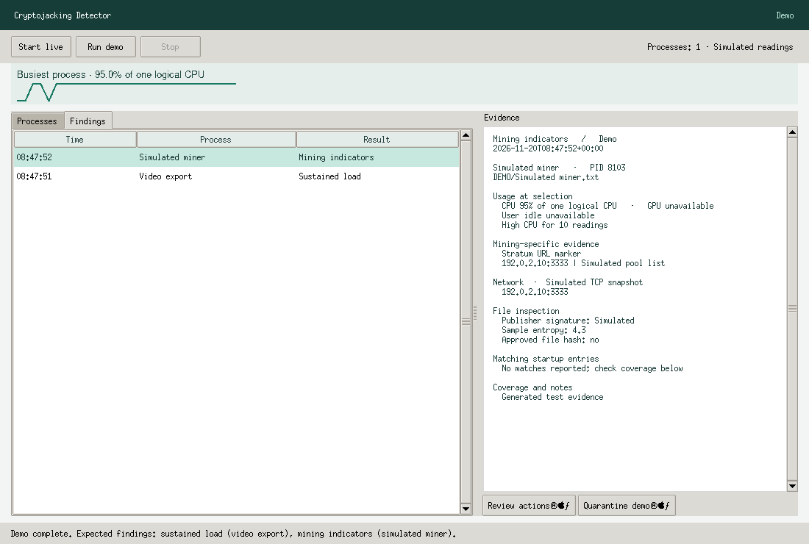

# Detecting suspected cryptojacking on Windows

## Objective

Identify local programs that use sustained computing resources or connect to a known mining-pool address. Show which observations belong to each process, collect evidence for review, and support user-directed remediation. Permission to mine is a separate fact that the device owner or administrator provides.

## Design and working

| Stage | Implementation | Output |
|---|---|---|
| System setup | Python and psutil enumerate accessible processes. PID plus process creation time identifies a running instance. The Windows helper reads OS records. | A process table and coverage status |
| Resource monitoring | CPU time deltas are divided by elapsed time. An alert fires at 80% of a logical CPU for 10 consecutive samples, about a second apart. A recovered process can start a new episode. | A sustained-load alert with the observed CPU reading |
| GPU and idle context | On Windows, formatted GPU-engine counters are queried independently. The highest observed engine value for each PID is used. Three distinct samples at or above 80% trigger a review. Windows session input idle time is context. | GPU percentage where supplied and seconds since last input |
| Network inspection | The app reads established local TCP peers. A background check approximately every 12 seconds looks for pool-associated addresses even at low CPU. The starter hostname is compared against the local Windows DNS cache. Exact IP rules also work without DNS. | Peer address, port and matching rule |
| Executable inspection | The first 4 MiB are examined for mining configuration markers such as a Stratum URL. Entropy estimates byte variability over that sample. SHA-256 for file approval covers the entire readable local file. The signature check obtains Windows Authenticode status. | Matched indicators, sample scope, entropy, signature and approval status |
| Startup investigation | Run/RunOnce entries for the user and machine, visible services and scheduled-task actions are compared to the executable path. | Matching entry names and unavailable evidence |
| User review | Dashboard, evidence panel, CSV and JSON Lines logs. Optional actions include Defender scan, file-hash approval, confirmed process termination and targeted startup review. | A human-readable reason and reviewable actions |

**Sustained load** means the process met a resource rule. **Mining indicators** means at least one configured mining marker or pool association was found. **Process review** records a manually inspected process without a matching rule. The finding is a clue for investigation. The demo produces identical CPU readings for a video export and a simulated miner to illustrate why the extra evidence matters.

The dashboard below shows simulated inputs from an actual run of the application during development.

## Evaluation

| Case | Result observed during development |
|---|---|
| Idle and short spike | No alert |
| Live bounded CPU workload on one logical CPU | One sustained-load finding at 99.9% in the test run |
| Twelve simulated high CPU readings for a video export | One sustained-load finding |
| Same load with a test pool destination and Stratum marker | One mining-indicators finding |
| Unlisted peer on a commonly associated port | No pool match from the port alone |
| Real local TCP connection with a temporary loopback IP rule | Matched the configured peer, including through the low-load connection check |
| Select a live process in the desktop app | Returned an executable path and a manual review |
| Close one process and reuse its PID in supplied test readings | The new creation time started a new counter |
| File-hash approval and sample quarantine | Verified adding and removing approval, rejecting changed bytes, moving the training file and restoring it |
| CSV and JSON Lines | Demo created two corresponding records in each format |

The desktop and portable detection components were exercised in Linux. The Windows GPU, DNS cache, signature, startup and Defender integrations require verification on the submission computer. A useful Windows check is to inspect a known user application, compare its PID and executable path with Task Manager, then compare displayed peers and hardware availability. Use the harmless training file for the quarantine demonstration.

## Interpretation and boundaries

- The bundled pool list is a starter list. Pool infrastructure changes. Edit **pools.json** with independently verified exact domains or dedicated IPs. Zero currently available pool IPs means network matching has no usable address at that point. The application makes no connection to a mining pool.
- A cached domain sharing a remote IP is weaker evidence than a mining URL in that process's arguments. Raw command-line arguments and credentials are not written to logs. TCP peer tables do not establish packet contents or traffic direction. Encrypted sessions, proxies and unknown or solo miners can escape the available indicators.
- The resource rules cover accessible processes and supported GPU counters. A low-load miner without a known peer or recognizable marker may be missed. A legitimate miner, renderer or research file can trigger a review. Sampling only part of a binary can miss embedded strings. High entropy alone does not trigger a mining verdict.
- Startup matching covers direct executable launches visible to the current account and registry view. Wrapper scripts, inaccessible tasks and other startup mechanisms need additional investigation. Signature and location are supporting context.
- Live file quarantine/removal is handled through Microsoft Defender and its configured policy. The reversible in-app quarantine exercise uses an app-created text file. A completed scan indicates that the scan ran. Consult Protection history for the actual verdict.

## References

- psutil, process inspection and network connections. https://psutil.readthedocs.io/stable/
- MITRE ATT&CK, behavioral detection of compute hijacking. https://attack.mitre.org/detectionstrategies/DET0540/
- Microsoft, Authenticode digital signatures. https://learn.microsoft.com/en-us/windows-hardware/drivers/install/authenticode
- Microsoft, Run and RunOnce registry keys. https://learn.microsoft.com/en-us/windows/win32/setupapi/run-and-runonce-registry-keys
- Microsoft, restoring quarantined files. https://learn.microsoft.com/en-us/defender-endpoint/restore-quarantined-files-microsoft-defender-antivirus
- The starter pool hostname source is recorded in pools.json.
